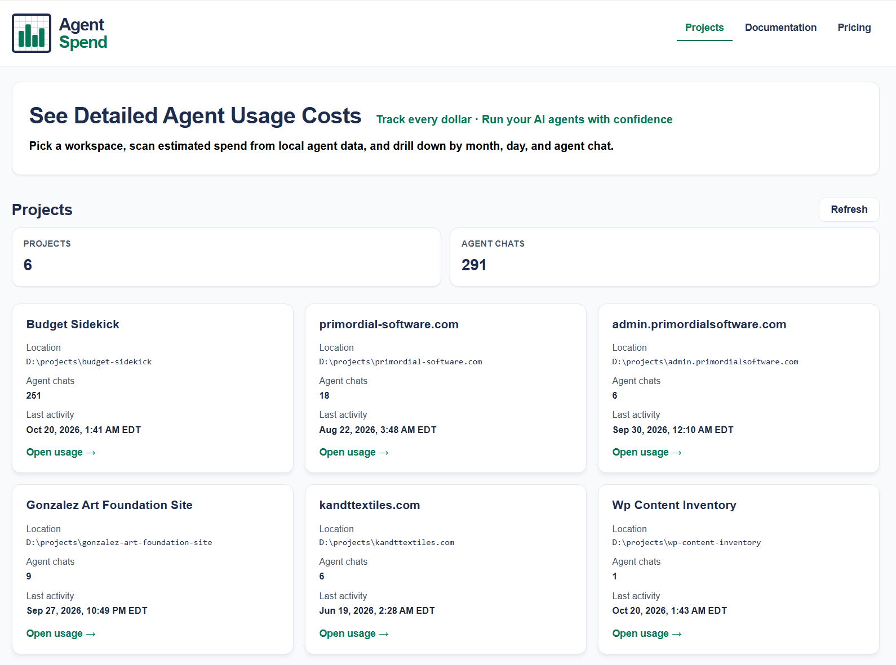
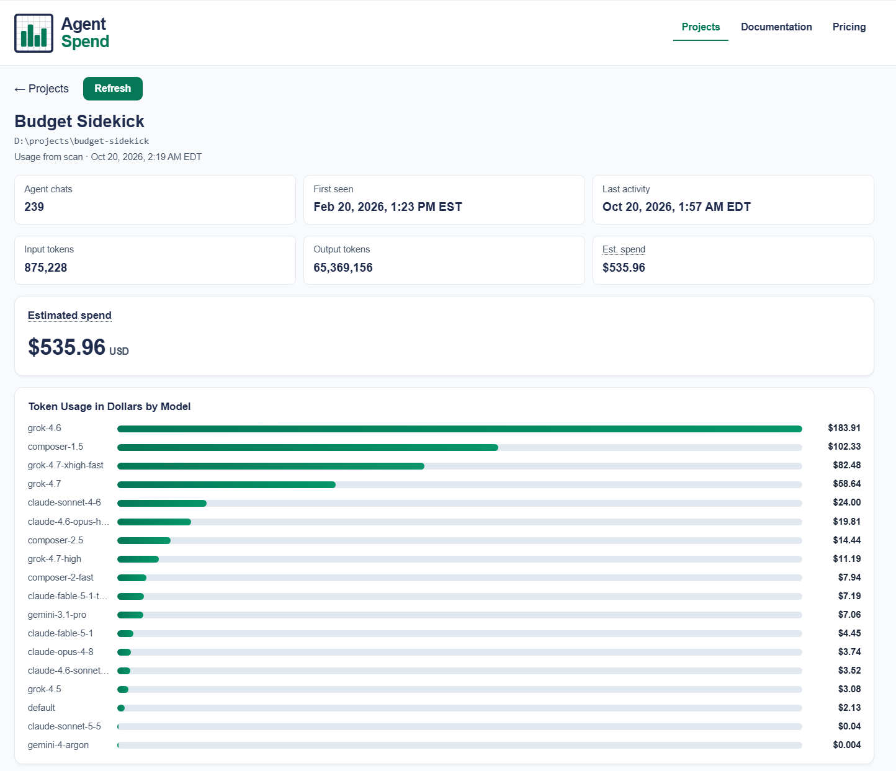
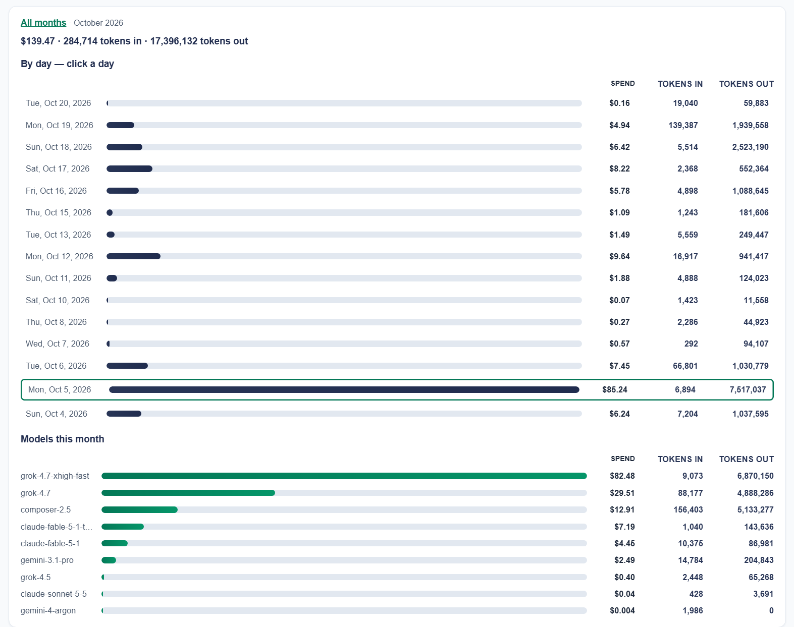
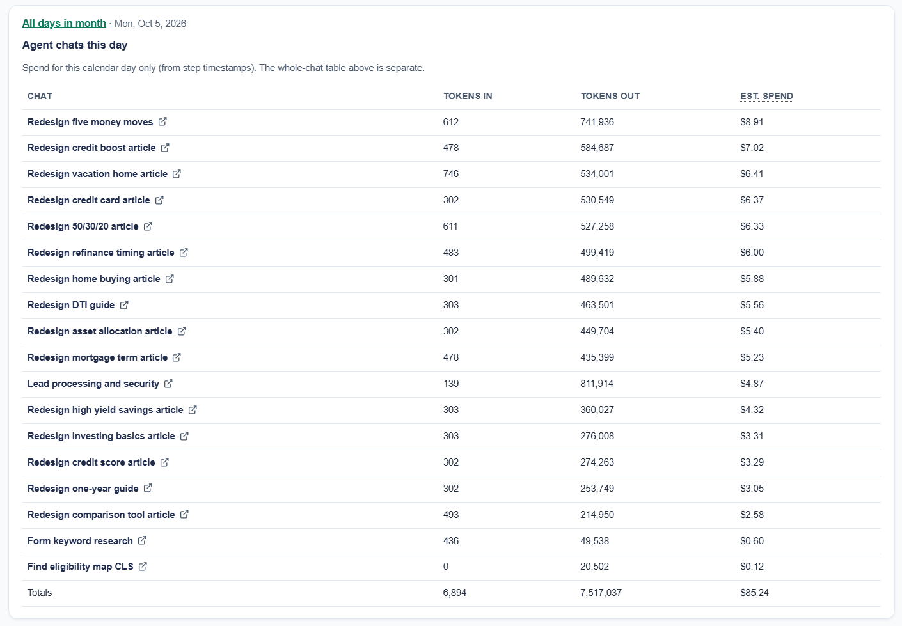
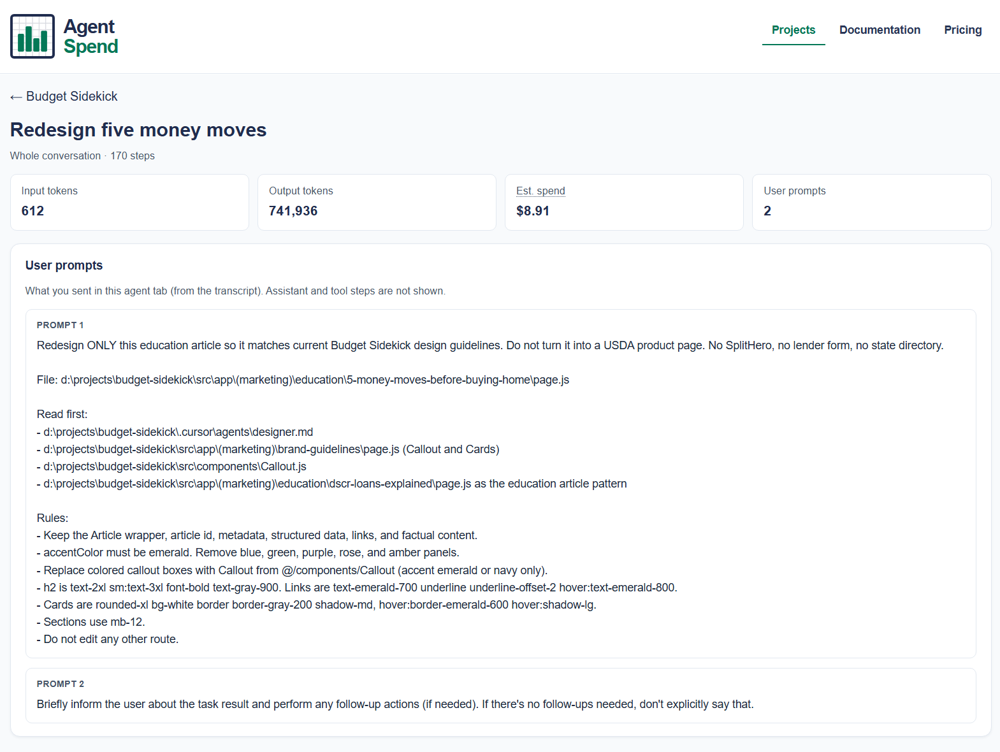

# Agent Spend

See what your Cursor agent chats cost — by project, model, month, day, and chat. Runs on your machine reading Cursor's local data.

```sh
git clone https://github.com/timg456789/agent-spend-ui.git
cd agent-spend-ui && npm install && npm run dev
```

## Screenshots

### Home

Pick a workspace and open estimated usage for that folder.



### Project

Scan rollups: totals, by month and day, models, and whole-chat spend.







### Chat

One agent conversation: token totals, models, and your prompts.



## What it answers

- Which **projects** are burning the budget.
- Which **models** inside a project cost the most (bar chart, by $).
- Which **chats** cost the most, whole-conversation (sortable table, opens the chat's prompts).
- **By month → by day → chats that day**, from per-step timestamps.
- Which model ids have **no price configured** so you can fix the table instead of trusting a $0.

## Requirements

- Node **22.13+** (uses the built-in `node:sqlite`; no native build step).
- Cursor installed on the same machine with at least one Agent chat.

Production server (after a build): `npm run build && npm start`.

## How the numbers are made

Agent Spend never calls Cursor's billing API. It reads two things Cursor already writes locally:

| Data | Where | Used for |
| --- | --- | --- |
| Agent transcripts | `~/.cursor/projects/<slug>/agent-transcripts/**/*.jsonl` | Which chats belong to which workspace; chat titles; your prompts |
| Composer state | `<Cursor User dir>/globalStorage/state.vscdb` (SQLite, opened read-only) | Per-step model, timestamps, `tokenCount`, and text/tool payload sizes |

For each step: if Cursor stored `tokenCount`, that's used. Otherwise tokens are estimated at ~4 characters per token from the stored text, thinking, code blocks and tool args/results. Spend = input tokens × input rate + output tokens × output rate, per model, from a pricing table (see below).

**What this is good for:** ranking chats, models, and days; spotting a runaway agent; seeing where a month went.
**What it is not:** an invoice. Cache reads/writes aren't visible locally, tool payloads inflate "output", and included plan usage is not subtracted. For dollars-to-the-cent, export the usage CSV from `cursor.com/dashboard → Usage`.

Full explanation lives in the app under **Documentation**.

## Pricing table

The data-access library **requires** you to pass `pricingTable` on every scan; Agent Spend does that in `server/lib/api.mjs` via `loadPricingTable()`. By default that uses **`pricing.json`** from the [`agent-spend-cursor-data-access`](https://www.npmjs.com/package/agent-spend-cursor-data-access) package (`loadDefaultPricingTable()`). To use your own file:

1. **`AGENT_SPEND_PRICING`** — absolute path to JSON (highest priority), or  
2. Add **`server/pricing.json`** in this repo (same schema: `$ / 1M` input and output per model id).

The server reloads override/local files when they change on disk. The **Pricing** page shows which source is active. Unknown model ids are not guessed; they're flagged on the project page until you add a row.

## Project layout

Next.js (App Router) front to back: pages and `/api/*` route handlers live under `src/app`, the data layer under `server/lib`.

Layout:

```
next.config.mjs         distDir build/, StrictMode off (it would double-start scans)
src/app/                routes: /, /project/[slug], /project/[slug]/chat/[id], /docs, /pricing
src/app/api/            route handlers: projects, project/[slug], project/[slug]/usage (SSE), agent-chat/[id]/*, pricing
src/views/, components/ client components (all data fetched from /api)
server/lib/api.mjs      orchestration; passes pricing into the data-access package
server/lib/pricing.mjs  override → server/pricing.json → package default
server/pricing.json     optional override (not committed unless you add one)
agent-spend-cursor-data-access (npm) transcripts + state.vscdb + default pricing.json
```

Environment overrides: `AGENT_SPEND_CURSOR_USER_DIR`, `AGENT_SPEND_CURSOR_HOME_DIR`, `AGENT_SPEND_PRICING`, `AGENT_SPEND_FILTER`, `AGENT_SPEND_EXCLUDE_SLUGS` (comma-separated project slugs omitted everywhere).

## Privacy

Binds to `127.0.0.1` only. Opens the Cursor database read-only. Writes nothing except `localStorage` in your own browser (last scan summary per project).

## License

MIT © Timothy Gonzalez
